<picture>
  <source media="(prefers-color-scheme: dark)" srcset="https://raw.githubusercontent.com/md-saqib/md-saqib/main/assets/header-dark.svg">
  
</picture>

  
  
  
  

## ✦ About

I turn complex Figma and Adobe designs into interfaces that are fast, accessible and easy to maintain. I care about the details users feel but rarely notice: smooth interactions, solid keyboard support, layouts that hold up on every screen, and pages that load before anyone has time to wait.

Outside the editor I write about web development, mobile apps, developer productivity and AI models on [my blog](https://mdsaqib.is-a.dev/blogs/).

## ✦ What I do

| | |
| --- | --- |
| 🎨 **Pixel-perfect interfaces** | Design files turned into reusable, component-driven UI that matches the mock to the pixel. |
| ⚡ **Fast Next.js frontends** | Server rendering, lean bundles and Core Web Vitals treated as a feature, not an afterthought. |
| ♿ **Accessible, responsive UIs** | Semantic markup, keyboard and screen-reader support, and fluid layouts from phone to ultrawide. |
| 🧩 **Drupal themes that scale** | Structured, maintainable theming that content teams can grow without breaking the design. |
| 🤖 **AI chatbots & assistants** | Conversational interfaces and assistants wired into real products. |

## ✦ How I work

  
  
  
  
  

## ✦ Stack

| | |
| --- | --- |
| **Languages** |  |
| **Frontend** |       |
| **Backend** |  |
| **Data** |  |
| **Cloud & tooling** |  |

## ✦ On GitHub

<picture>
  <source media="(prefers-color-scheme: dark)" srcset="https://raw.githubusercontent.com/md-saqib/github-stats/master/generated/overview-dark.svg">
  
</picture>
<picture>
  <source media="(prefers-color-scheme: dark)" srcset="https://raw.githubusercontent.com/md-saqib/github-stats/master/generated/languages-dark.svg">
  
</picture>
<picture>
  <source media="(prefers-color-scheme: dark)" srcset="https://raw.githubusercontent.com/md-saqib/github-stats/master/generated/activity-dark.svg">
  
</picture>
<picture>
  <source media="(prefers-color-scheme: dark)" srcset="https://raw.githubusercontent.com/md-saqib/github-stats/master/generated/mix-dark.svg">
  
</picture>
<picture>
  <source media="(prefers-color-scheme: dark)" srcset="https://raw.githubusercontent.com/md-saqib/github-stats/master/generated/rhythm-dark.svg">
  
</picture>

## ✦ Latest writing

<!-- BLOG-POST-LIST:START -->- [Shipping Source Maps to Production Without Exposing Your Source](https://mdsaqib.is-a.dev/blogs/shipping-source-maps-production-expose-source/) · Nov 12, 2026
- [Working Within Android Background Execution Limits](https://mdsaqib.is-a.dev/blogs/working-android-background-execution-limits/) · Nov 10, 2026
- [Editor LSP That Stays Responsive in a Large Monorepo](https://mdsaqib.is-a.dev/blogs/lsp-responsiveness-large-monorepo/) · Nov 2, 2026
- [Fast TypeScript CLI startup with esbuild and lazy imports](https://mdsaqib.is-a.dev/blogs/fast-typescript-cli-startup/) · Oct 29, 2026
- [Guardrails: Validating Input Before It Reaches the Model](https://mdsaqib.is-a.dev/blogs/input-guardrails-llm-validation/) · Oct 26, 2026
<!-- BLOG-POST-LIST:END -->

<a href="https://mdsaqib.is-a.dev/blogs/">All posts →</a>

---

✦ The best systems are invisible, scalable, and predictable. ✦

